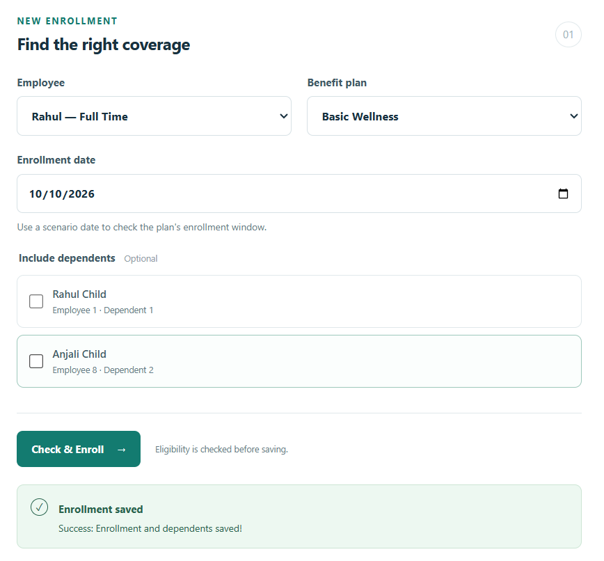

# TC01 — User-provided enrollment screenshot

Evidence recorded: October 28, 2026, Asia/Kolkata.
Actual execution date and tested application commit: not provided.
Method: human browser execution reported by the user; screenshot reviewed by the assistant.

## Visible evidence
- Employee: Rahul — Full Time (employee 1 in the documented baseline).
- Plan: Basic Wellness (plan 2 in the documented baseline).
- Scenario date: October 10, 2026.
- Both dependent checkboxes are unchecked.
- Result: Enrollment saved; Success: Enrollment and dependents saved!

## Interpretation
The screenshot supports the UI-response portion of TC01. The generic success wording does not prove that dependent links were inserted.
Status: **In Progress**, pending persistence verification.

To complete the case, provide the saved enrollment record and the expected total of two enrollments after starting from the baseline. Database or record evidence must also confirm that no dependent links were added for this enrollment. Do not infer those facts from the success message.

The existing automated scenario result remains separate and unchanged. It is not a substitute for verifying this particular user execution.
